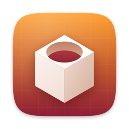
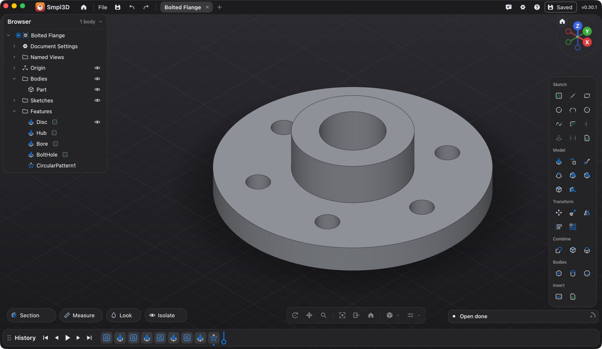
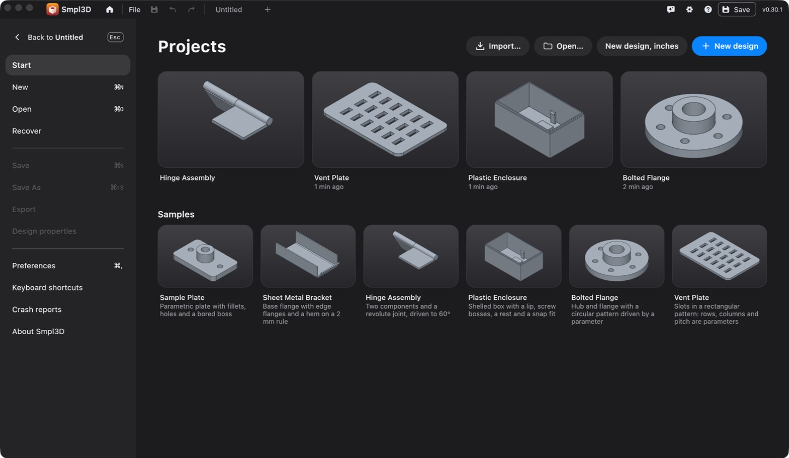
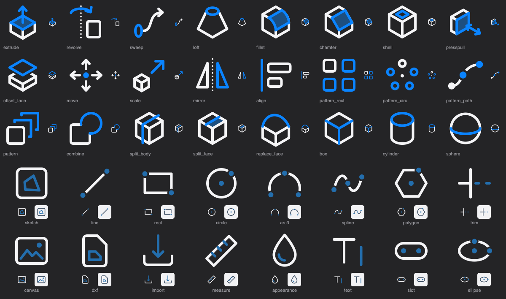

<p align="center">
  
</p>

<h1 align="center">Smpl3D</h1>

<p align="center">
  A Mac CAD app that feels like a modern Apple app: direct modelling, a clean dark interface,<br>
  and a parametric history underneath when you want it.
</p>

<p align="center">
  
  
  
</p>

<p align="center">
  
</p>

## What it is

Smpl3D is a personal fork of [SolidCraft](https://github.com/tangency-labs/solidcraft), a
pure-Rust parametric CAD program, reshaped around one idea: you should be able to pick something
and pull it. Select a face and an arrow appears; drag it and the part changes. The feature
timeline is still recorded underneath, so every pull can be edited later.

It runs natively on Apple Silicon, draws with Metal, imports STEP files and meshes, and exports
STEP, STL, 3MF and DXF.

## A look around

### Projects

Every design saves itself as you work and shows up here as a large preview, newest first.

<p align="center">
  
</p>

### Icons

About 270 tool icons were redrawn as single-weight line art with one accent colour, so the
palette reads as one family at small sizes.

<p align="center">
  
</p>

## What Smpl3D changes

| Area | What you get |
|---|---|
| **Select, then act** | A selected face shows an extrude arrow, an edge shows a fillet and chamfer arrow, a hole or cylinder shows an arrow that grows or shrinks it. Drag to start the tool and set its value in one go. |
| **One Offset tool** | Faces move, sketch lines and areas get new lines a distance away, body edges become a new sketch on their face. |
| **Move** | Double-click a body for arrows and rings. With Copy on, each drag drops a copy. Align and Scale sit beside it and carry the selection over. |
| **Tool palette** | A compact palette on the right (Sketch, Model, Transform, Combine, Bodies, Insert) replaces the ribbon. The ribbon is one preference away. |
| **Navigation** | Right-drag orbits, middle-drag pans, pinch or wheel zooms; two-finger swipe orbits on a trackpad. |
| **Shortcuts** | `L` `R` `C` `A` for sketching, `E` `F` `H` `M` `S` for modelling, `X` to search, `⌘1` to `⌘7` for views. |
| **Autosave** | Designs save themselves into one Projects folder a moment after each change. |
| **Look** | Neutral dark greys, system blue, the Mac's own San Francisco font, rounded panels, and menus that show `⌘S` rather than `Ctrl+S`. |
| **Measure as you go** | The selection bar shows area, length and diameter for whatever is picked. Flat faces show their centre, and sketch tools snap to it. |
| **Reference images and DXF** | Place a picture on a plane and calibrate it with two clicks; bring a DXF into a sketch or save one out. |

## Build it

Smpl3D needs macOS on Apple Silicon, Xcode's command-line tools and a recent stable Rust.

```sh
git clone <this repository>
cd <this repository>
cargo build --release -p smpl3d -p smpl3d-cli
./target/release/smpl3d
```

The first build compiles the whole geometry kernel and takes a while; later builds take a few
minutes. The build folder grows to tens of gigabytes and can be deleted at any time.

`smpl3d/local/` holds the scripts used on the author's machine to wrap the binary into
`Smpl3D.app`, install it into `/Applications`, and redraw the icon (`make_brand.swift`).

## Where things are

| Path | What it holds |
|---|---|
| `crates/kernel` | The B-rep geometry kernel (built on [truck](https://github.com/ricosjp/truck)) |
| `crates/engine` | Commands: every modelling operation is one |
| `crates/doc` | The design document and its file format |
| `crates/ui-egui` | The interface. Smpl3D's own tools are in `src/smpl3d.rs` |
| `apps/smpl3d` | The desktop app; `apps/smpl3d-cli` runs designs and scripts from a terminal |
| `assets/icons/ui/design/svg` | The icon masters |
| `assets/styles/ui` | The built-in palette and the theme files |
| `AGENTS.md`, `skills/` | The rules and guides this codebase is developed under |

## Status

This is one person's working tool, not a product. It is used daily and changes often.

- macOS only is tested. The upstream project also targets Windows, Linux and the web; those
  builds have not been tried from this fork.
- A number of upstream interface tests were written for the ribbon layout and fail with
  Smpl3D's palette enabled. Kernel and engine tests are run for each change.
- There are no releases or installers here. Build it from source.

## Credits and licence

Smpl3D is built on [SolidCraft](https://github.com/tangency-labs/solidcraft), copyright © 2026
SolidCraft contributors, used and modified under the MIT and Apache 2.0 licences. Their licence
texts and notice are kept unchanged in [`LICENSE-MIT`](LICENSE-MIT),
[`LICENSE-APACHE`](LICENSE-APACHE) and [`NOTICE`](NOTICE), and are shown in the app under
Help › About › Licences. Third-party components are listed in
[`THIRD-PARTY-LICENSES.txt`](THIRD-PARTY-LICENSES.txt) and [`ATTRIBUTION.md`](ATTRIBUTION.md).

Smpl3D's own changes are offered under the same two licences.

Smpl3D is not affiliated with or endorsed by Shapr3D, Apple or any other CAD vendor. Its icons
and artwork are original drawings.
