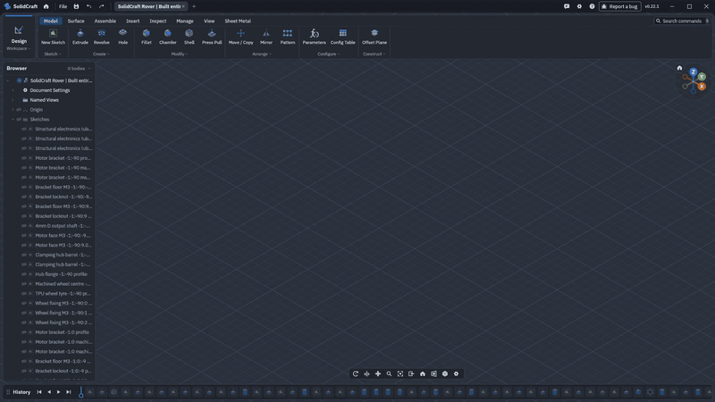

# Built with Smpl3D

*SELENE, a scientific rover built entirely through Smpl3D's MCP server by
[@0xlillith](https://github.com/0xlillith/smpl3d-rover): 3,323 editable timeline steps that
rebuild with no errors, replayed here at 15× speed with the idle moments cut.
[Full video](https://github.com/tangency-labs/smpl3d/raw/refs/heads/main/docs/screenshots/rover-build.mp4)
· [download the editable model](https://github.com/0xlillith/smpl3d-rover/releases/tag/v1.0.0).*
